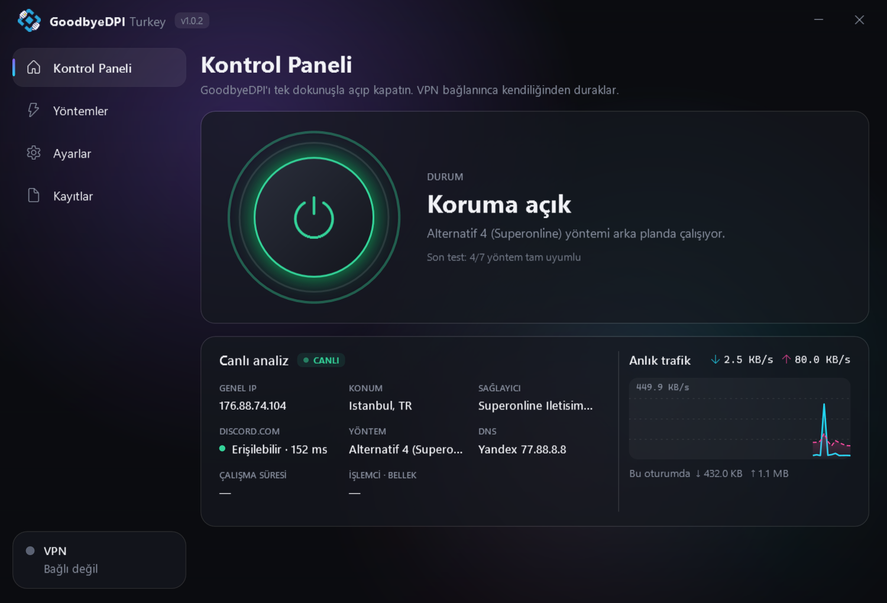
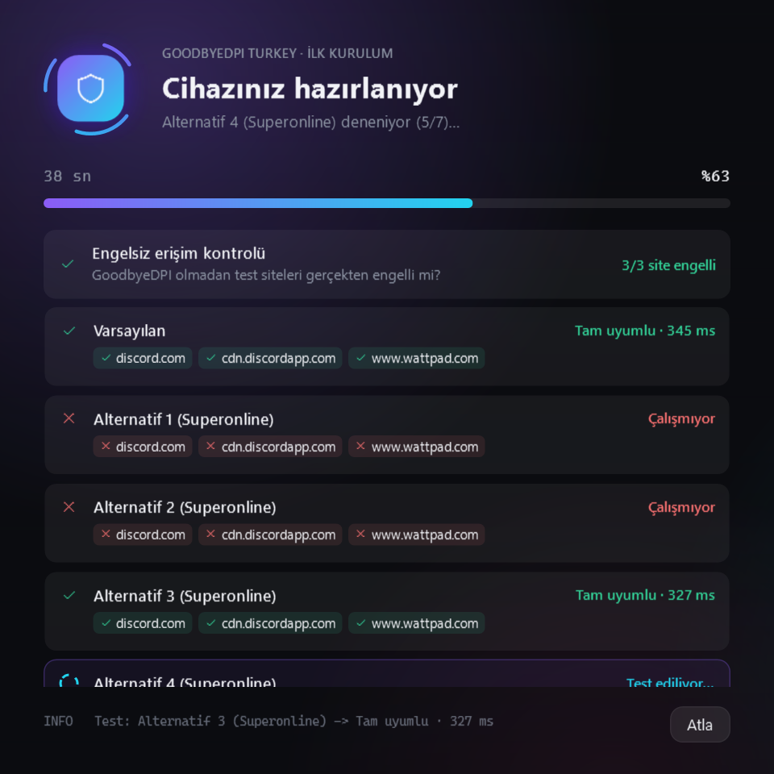
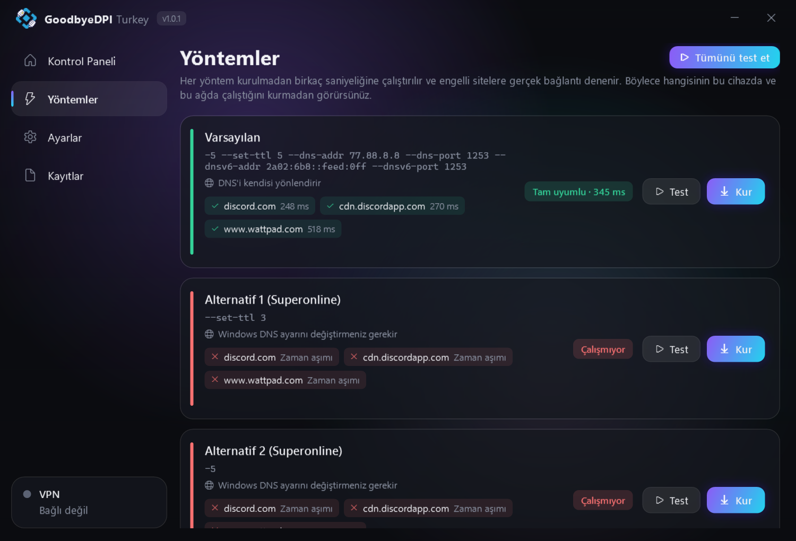
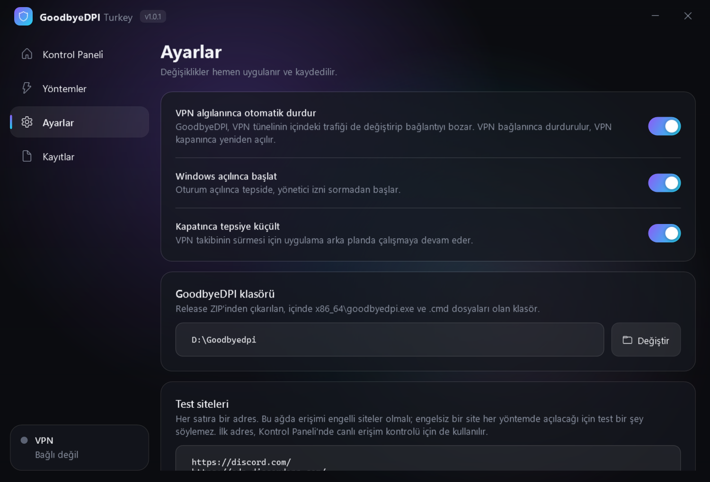
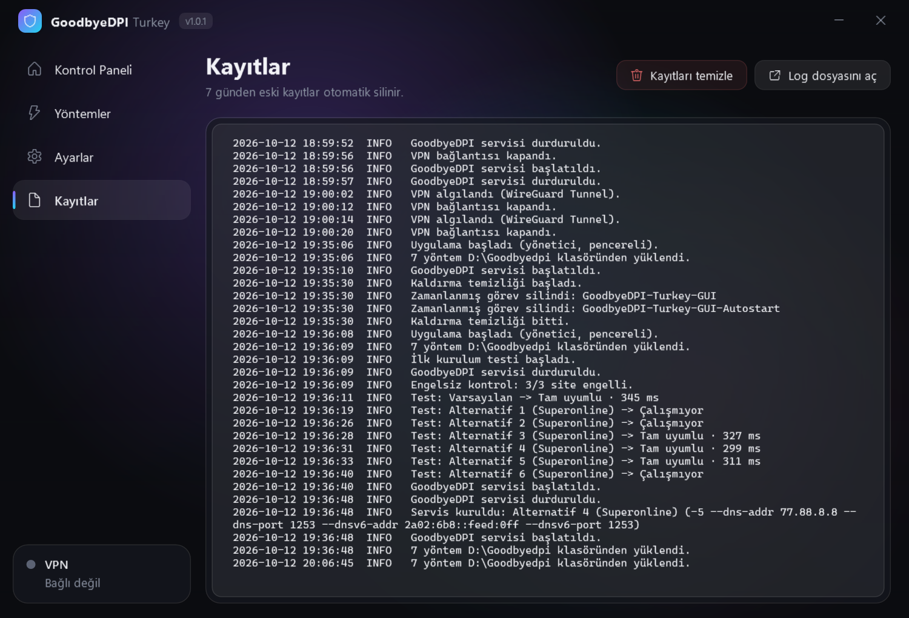

<div align="center">

# GoodbyeDPI Turkey — Windows Kontrol Paneli

**Hangi yöntemin sizin ağınızda çalıştığını kurmadan test edin, tek dokunuşla açıp kapatın.**

[](https://github.com/TrinsyCa/GoodbyeDPI-Turkey/releases/latest)
[-22d3ee.svg)](#kurulum)
[](LICENSE)

### [⬇ Setup'ı indir — GoodbyeDPI-Turkey-GUI-Setup-1.0.0.msi](https://github.com/TrinsyCa/GoodbyeDPI-Turkey/releases/download/gui-v1.0.0/GoodbyeDPI-Turkey-GUI-Setup-1.0.0.msi)

<sub>Windows 10/11 x64 · 63 MB · .NET ve GoodbyeDPI dosyaları içinde · [Tüm sürümler](https://github.com/TrinsyCa/GoodbyeDPI-Turkey/releases)</sub>

</div>

> [!NOTE]
> Bu bölüm, bu fork'a (**[TrinsyCa/GoodbyeDPI-Turkey](https://github.com/TrinsyCa/GoodbyeDPI-Turkey)**) eklenen **Windows kontrol paneli** uygulamasını anlatır.
> Asıl projenin ([cagritaskn/GoodbyeDPI-Turkey](https://github.com/cagritaskn/GoodbyeDPI-Turkey)) README'si değiştirilmeden **[aşağıda](#orijinal-goodbyedpi-turkey-readme)** duruyor.



## Uygulamanın amacı

GoodbyeDPI-Turkey, Türkiye'deki internet sağlayıcılarının farklı DPI (derin paket inceleme) davranışları için 7 ayrı yöntem sunar. Hangisinin çalışacağı ağdan ağa, hatta aynı sağlayıcıda modemden modeme değişir. Uygulamadan önceki kullanım şöyleydi:

- `.cmd` dosyalarını **tek tek yönetici olarak çalıştırıp** hangisinin işe yaradığını elle denemek,
- `turkey_dnsredir_*_superonline.cmd` yöntemlerinde **terminal penceresini sürekli açık tutmak**,
- açıp kapatmak için servisleri elle kaldırıp kurmak,
- VPN bağlanınca GoodbyeDPI'ın **VPN tünelini bozmasını** (`ERR_CONNECTION_RESET`, `ERR_SSL_PROTOCOL_ERROR`) elle çözmek.

Bu uygulama bunların hepsini tek bir arayüzde topluyor: **yöntemleri kurmadan test eder, sizin cihazınızda çalışanı önerir, tek tıkla kurar ve arka planda çalıştırır.** VPN bağlanınca GoodbyeDPI'ı kendiliğinden durdurur.

## Özellikler

| | |
|---|---|
| 🚀 **İlk açılışta otomatik test** | Uygulama ilk kez açıldığında, ana pencere açılmadan önce tüm yöntemler bu ağda canlı olarak test edilir ve en iyisi önerilir. |
| 🧪 **Kurmadan test** | Her yöntem birkaç saniyeliğine gizli bir işlem olarak çalıştırılır ve engelli sitelere gerçek HTTPS bağlantısı denenir. Site bazında ✓/✗ ve gecikme gösterilir. |
| ⏻ **Tek dokunuşla aç/kapat** | Seçilen yöntem Windows servisi olarak kurulur: terminal açık kalmaz, bilgisayar yeniden başlayınca da çalışır. |
| 🛡️ **VPN algılama** | Proton VPN, WireGuard, OpenVPN, NordVPN, Mullvad gibi VPN'ler bağlanınca GoodbyeDPI durdurulur, VPN kapanınca geri açılır. Ayarlardan kapatılabilir. |
| 📈 **Canlı analiz** | Genel IP, konum, sağlayıcı, engelli siteye anlık erişim, aktif yöntem, DNS, çalışma süresi, işlemci/bellek ve son 60 saniyenin trafik grafiği. |
| 🔑 **Tek UAC onayı** | Yönetici izni yalnızca ilk açılışta istenir, sonraki açılışlarda sorulmaz. |
| 🔗 **Repoya bağlı yöntemler** | Yöntemler `windows/service_install_*.cmd` dosyalarından okunur. Repoya yeni bir `.cmd` eklendiğinde uygulamada kendiliğinden görünür. |
| 🧰 **Çakışma tespiti** | Servisi dışarıdan açıp kapatan script ya da elle başlatılmış `goodbyedpi.exe` bulunursa uyarır ve tek tıkla kaldırır. |
| 🧹 **Kayıt temizliği** | Servis, VPN ve test olaylarının kaydı tutulur. 7 günden eski kayıtlar otomatik silinir; istenirse tek tıkla hepsi temizlenir. |
| 🖥️ **Tepside çalışma** | Windows açılınca tepside başlar. Pencere kapatılınca VPN takibi arka planda sürer. |

## Ekran görüntüleri

<table>
  <tr>
    <td width="50%"><b>İlk açılış kurulumu</b><br>Yöntemler uygulama açılmadan, canlı olarak test edilir.<br><br></td>
    <td width="50%"><b>Yöntemler</b><br>Her yöntemin bu ağdaki sonucu, site bazında.<br><br></td>
  </tr>
  <tr>
    <td width="50%"><b>Ayarlar</b><br>VPN algılama, Windows ile başlatma, test siteleri.<br><br></td>
    <td width="50%"><b>Kayıtlar</b><br>Servis, VPN ve test olayları; otomatik ve elle temizleme.<br><br></td>
  </tr>
</table>

## Kurulum

1. **[GoodbyeDPI-Turkey-GUI-Setup-1.0.0.msi](https://github.com/TrinsyCa/GoodbyeDPI-Turkey/releases/download/gui-v1.0.0/GoodbyeDPI-Turkey-GUI-Setup-1.0.0.msi)** dosyasını indirin (ya da **[Releases](https://github.com/TrinsyCa/GoodbyeDPI-Turkey/releases)** sayfasından en son sürümü seçin).
2. Setup'ı çalıştırın. Uygulama `C:\Program Files\GoodbyeDPI Turkey` klasörüne kurulur; Başlat menüsüne ve masaüstüne kısayol eklenir.
3. Uygulama ilk açılışta bir kez yönetici izni ister, ardından yöntemleri test eden kurulum ekranı açılır.
4. Test bitince **"Önerileni kur ve başla"** ile bitirin.

> [!TIP]
> Setup; .NET çalışma ortamını, `goodbyedpi.exe`'yi, WinDivert sürücüsünü ve tüm yöntemleri içinde getirir. Ayrıca ZIP indirmeniz ya da .NET kurmanız gerekmez.

> [!IMPORTANT]
> Test sırasında VPN **kapalı** olmalı. VPN açıkken trafik VPN'den geçtiği için test bu ağı ölçemez; kurulum ekranı bunu algılar ve VPN'i kapatmanızı ister.

## Kullanım

- **GoodbyeDPI'ı açmak/kapatmak:** Kontrol Paneli'ndeki güç düğmesine dokunun. Ya da görev çubuğundaki tepsi simgesine sağ tıklayıp **"GoodbyeDPI'ı aç/kapat"** seçeneğini kullanın.
- **Uygulamayı açmak:** Masaüstü ya da Başlat menüsündeki **GoodbyeDPI Turkey** kısayolunu kullanın. Uygulama zaten açıksa mevcut pencere öne gelir.
- **Uygulamayı kapatmak:** Penceredeki **✕** düğmesi uygulamayı kapatmaz, tepsiye küçültür; VPN takibi sürer. Tamamen çıkmak için tepsi simgesine sağ tıklayıp **Çıkış**'ı seçin.

> [!NOTE]
> Uygulamayı kapatmak GoodbyeDPI'ı kapatmaz. GoodbyeDPI bir Windows servisi olarak çalışmaya devam eder; uygulama kapalıyken yalnızca VPN algılama çalışmaz.

- **Kayıtlar:** **Kayıtlar** sayfasında servis işlemleri, VPN olayları ve test sonuçları görünür. 7 günden eski kayıtlar kendiliğinden silinir; **Kayıtları temizle** ile hepsi silinebilir.
- **Yöntem değiştirmek:** **Yöntemler** sayfasında **Tümünü test et**'e basın, sonra istediğiniz yöntemde **Kur**'a basın. Ağ değiştirdiyseniz (ör. başka bir modem ya da mobil hotspot) testi tekrarlamanız önerilir.

## Nasıl çalışır?

<details>
<summary><b>Yöntem testi</b></summary>

1. Çalışan GoodbyeDPI servisi geçici olarak durdurulur.
2. **Engelsiz kontrol:** GoodbyeDPI olmadan test sitelerine bağlanılır. Siteler zaten açılıyorsa test anlamsızdır ve uygulama bunu söyler.
3. Her yöntem için `goodbyedpi.exe` o yöntemin argümanlarıyla gizli bir alt işlem olarak başlatılır, Windows DNS önbelleği temizlenir (eski zehirli DNS cevapları sonucu yanıltmasın) ve sitelere gerçek HTTPS isteği atılır. TLS el sıkışması tamamlanırsa yöntem o site için çalışıyor sayılır.
4. Her adımda servisin kapalı olduğu doğrulanır; başka bir program servisi açarsa test sonuçları güvenilmez olarak işaretlenir.
5. Test bitince servis eski durumuna döner. Tüm siteleri açan yöntemler arasında DNS'i kendisi yönlendiren ve en hızlı olan önerilir.

Varsayılan test siteleri `discord.com`, `cdn.discordapp.com` ve `www.wattpad.com`. **Ayarlar → Test siteleri** bölümünden değiştirilebilir.
</details>

<details>
<summary><b>Tek UAC onayı</b></summary>

Uygulama ilk açılışta kendini **"en yüksek yetkiyle çalış"** ayarlı bir zamanlanmış göreve (`GoodbyeDPI-Turkey-GUI`) kaydeder. Sonraki açılışlarda yetkisiz açılan kopya bu görevi tetikler; Görev Zamanlayıcı da uygulamayı UAC sormadan yönetici olarak başlatır. Görev sabit bir exe yolunu argümansız çalıştırır.

Bu yüzden Setup uygulamayı **Program Files**'a kurar: o klasöre yönetici olmadan yazılamadığı için başka bir program exe'yi değiştirip bu görev üzerinden yönetici yetkisi kazanamaz.
</details>

<details>
<summary><b>VPN algılama</b></summary>

GoodbyeDPI, WinDivert sürücüsüyle tüm ağ kartlarındaki trafiğe müdahale eder ve hangi trafiğin VPN tünelinden geçtiğini ayırt edemez. `--set-ttl` ile gönderdiği sahte paketler tünelin içinden VPN sunucusuna, oradan da hedef siteye ulaşır ve bağlantıyı bozar. Bu yüzden uygulama VPN adaptörlerini ve Proton VPN'in WireGuard servisini 2 saniyede bir kontrol eder. VPN bağlanınca servisi durdurur, kapanınca geri açar. Yalnızca kendi durdurduğu servisi geri açar: GoodbyeDPI'ı siz kapattıysanız VPN kapanınca açılmaz.
</details>

## Gizlilik ve güvenlik

- Uygulama telemetri göndermez. Ayarlar ve loglar yalnızca `C:\ProgramData\GoodbyeDPI-Turkey-GUI\` altında tutulur; loglar 7 gün sonra silinir.
- Canlı analizdeki genel IP, konum ve sağlayıcı bilgisi için **[ipinfo.io](https://ipinfo.io)**'ya 5 dakikada bir istek atılır. Erişim kontrolü için ilk test sitesine 45 saniyede bir bağlanılır.
- Sisteme bıraktıkları: `GoodbyeDPI` Windows servisi, WinDivert sürücüsü, `GoodbyeDPI-Turkey-GUI` ve `GoodbyeDPI-Turkey-GUI-Autostart` zamanlanmış görevleri. Setup ile kaldırınca görevler silinir; servis bu kurulumdaki `goodbyedpi.exe`'yi kullanıyorsa o da kaldırılır.

## Kaldırma

**Ayarlar → Uygulamalar → GoodbyeDPI Turkey → Kaldır**. Yalnızca GoodbyeDPI servisini kaldırmak isterseniz uygulamada **Ayarlar → Servisi kaldır**'ı kullanın (`service_remove.cmd` ile aynı işi yapar).

## Kaynaktan derleme

Gereksinimler: Windows 10/11 x64, [.NET 8 SDK](https://dotnet.microsoft.com/download/dotnet/8.0).

```powershell
# Uygulamayı derleyip çalıştırmak
dotnet run --project gui\GoodbyeDPI.Gui

# Setup (MSI) oluşturmak: GoodbyeDPI release ZIP'i ya da açıldığı klasör gerekir
.\gui\build-installer.ps1 -GoodbyeDpi "$env:USERPROFILE\Downloads\goodbyedpi-0.2.3rc3-turkey.zip"

# README ekran görüntülerini yenilemek (yetki gerektirmez, hiçbir şeyi değiştirmez)
.\gui\GoodbyeDPI.Gui\bin\Debug\net8.0-windows\GoodbyeDPI-Turkey-GUI.exe --screenshots docs\gui
```

| Klasör | İçerik |
|---|---|
| [`gui/GoodbyeDPI.Gui`](gui/GoodbyeDPI.Gui) | WPF uygulaması (.NET 8) |
| [`gui/GoodbyeDPI.Gui/Core`](gui/GoodbyeDPI.Gui/Core) | Servis yönetimi, yöntem testi, VPN izleme, canlı analiz, yetki yükseltme |
| [`gui/installer`](gui/installer) | WiX 5 ile MSI kurulum paketi |
| [`gui/build-installer.ps1`](gui/build-installer.ps1) | Tek komutla Setup üretir |

## Teşekkürler

- **[ValdikSS/GoodbyeDPI](https://github.com/ValdikSS/GoodbyeDPI)**: asıl DPI atlatma aracı
- **[cagritaskn/GoodbyeDPI-Turkey](https://github.com/cagritaskn/GoodbyeDPI-Turkey)**: Türkiye uyarlaması ve yöntemler
- **[basil00/WinDivert](https://github.com/basil00/WinDivert)**: paket yakalama sürücüsü

Uygulama, bu repodaki diğer kodlar gibi [Apache 2.0](LICENSE) lisanslıdır.

<br>

---

<a id="orijinal-goodbyedpi-turkey-readme"></a>

# Orijinal GoodbyeDPI-Turkey README'si

> [!NOTE]
> Bu çizginin altındaki bölüm, asıl proje **[cagritaskn/GoodbyeDPI-Turkey](https://github.com/cagritaskn/GoodbyeDPI-Turkey)**'nin README'sidir ve değiştirilmeden korunmuştur. `.cmd` dosyalarıyla elle kurulum, macOS desteği ve sorun giderme için buraya bakın.

---

[](LICENSE)
[](#)
[](https://github.com/cagritaskn/GoodbyeDPI-Turkey/releases/)

> **macOS desteği:** Bu fork artık macOS'ta da çalışır (Intel ve Apple Silicon).
> Hızlı başlangıç için **[`macOS Kullanıcıları İçin`](https://github.com/cagritaskn/GoodbyeDPI-Turkey#macos-kullan%C4%B1c%C4%B1lar%C4%B1-i%CC%87%C3%A7in)** başlığını ziyaret edebilirsiniz.

> Detaylı kurulum ve kullanım talimatları için **[`macos/README.md`](macos/README.md)** dosyasına bakın.


# SplitWire-Turkey Hakkında Önemli Not (29.07.2025)
>
> [!IMPORTANT]
> Bazı kullanıcılar Discord'a erişmekte veya diğer web sitelerindeki bazı içeriklerin yüklenmemesi hakkında geri bildirimde bulunduğundan farklı metotlarla ancak aynı işlev ile çalışan **[SplitWire-Turkey](https://github.com/cagritaskn/SplitWire-Turkey)** uygulamasını yayınladık. GoodbyeDPI'ı kaldırdıktan sonra ([GoodbyeDPI-Turkey Doğru Şekilde Kaldırma Rehberi](https://github.com/cagritaskn/GoodbyeDPI-Turkey/blob/master/REVERT.md)) **[bu aracımızı](https://github.com/cagritaskn/SplitWire-Turkey)** kullanmayı deneyebilirsiniz.

# Kaspersky Antivirüsü Hakkında Önemli Not (13.01.2025)
>
> [!CAUTION]
> Kaspersky isimli antivirüs yazılımı Rus hükümetiyle olan anlaşmasından dolayı GoodbyeDPI'ın çalışmasına engel olmaktadır. Kaspersky isimli yazılımı kullanıyorsanız, kullandıysanız veya devre dışı halde bile olsa bilgisayarınızda bulunuyorsa lütfen tamamen kaldırın. Bunu yapmadığınız taktirde GoodbyeDPI çok yüksek ihtimalle çalışmayacaktır. Kaspersky yerine alternatif antivirüs yazılımları tercih edebilir ya da Windows Defender kullanabilirsiniz. (Windows Defender 2025 yılı itibariyle kötü amaçlı yazılım ve siteleri engellemekte son derece yeterlidir.)
Kaspersky'i GoodbyeDPI ZIP dosyasının indirme işlemi sırasında devre dışı bırakmanız, indirdikten sonra dışlamalara eklemeniz veya devre dışı bırakmanız sorunu çözmeyecektir. GoodbyeDPI'ı doğru şekilde kullanabilmek için Kaspersky isimli antivirüs yazılımından bir şekilde kurtulmalısınız.

## Özet​

Bu proje Discord ve diğer engelli site ve uygulamalara VPN'siz ve internet hızında yavaşlama olmadan girmek için GoodbyeDPI'ın düzenlenmiş bir versiyonudur.

## GoodbyeDPI — Derin Paket İnceleme (DPI) atlatma aracı (Türkiye versiyonu)

Bu uygulama, Türkiye'de bazı internet servis sağlayıcılarının DNS değişikliğine izin vermemesi sebebiyle, bu durumu bertaraf etmek için asıl proje olan [GoodbyeDPI](https://github.com/ValdikSS/GoodbyeDPI)'ın düzenlenmiş bir versiyonudur.
Bu yazılım, birçok ISS'da (İnternet Servis Sağlayıcısı) bulunan ve belirli web sitelerine erişimi engelleyen "Derin Paket İnceleme" (DPI) sistemlerini atlatmak için tasarlanmıştır.
Optik ayırıcı veya port yansıtma (Pasif DPI) kullanarak bağlanan ve herhangi bir veriyi engellemeyen, ancak istenen hedeften daha hızlı yanıt veren DPI'yi ve sıralı olarak bağlanan Aktif DPI'yi işler. Bu uygulama kesinlikle bir VPN değildir ve oyunlarda/genel internet kullanımında bir hız değişikliğine sebep olmayacaktır.

> [!NOTE]
> Windows 7, 8, 8.1, 10 veya 11 işletim sistemlerinde **yönetici olarak çalıştırmanız** mecburidir.

## Virüs & Veri Sızıntısı & Bitcoin Mining

Program açık kaynak kodlu olduğundan tüm kodu görüp inceleyebilirsiniz. Bazı kullanıcılar VirusTotal'de false positive bildirimi yapsa da bu ``WinDivert.dll`` ve ``WinDivert64.sys`` dosyalarının fonksiyonlarından dolayı bu şekilde yanlış bir sonuç verebiliyor (bu dosyalar sistemi etkiler). Bu .dll ve .sys dosyaları da açık kaynak kodludur ve incelenebilir, yani tamamen temizdir. İstemeyen ve güvenmeyen kullanıcılar kullanmak zorunda değildir, herkesin kendi seçimidir.
Dilerseniz tüm klasörü ya da .zip dosyasını [VirusTotal](https://www.virustotal.com/gui/home/upload) gibi bir sitede taratıp sonuçları inceleyebilirsiniz.
> [!NOTE]
> **[VirusTotal sonuçlarında](https://www.virustotal.com/gui/file/3ca863444ce065361b1152e1dddae1147962fc78b90c17ff346efbb35bd146ee)** 73 adet antivirüs progamı içerisinde (bağlantıyla yönlendirileceğiniz sayfada 66 adet antivirüs programı bulunmakta çünkü bazıları ``.zip`` dosyalarını online taramayı desteklememekte) yalnızca Kaspersky isimli uygulama bu yazılımın zararlı olduğunu söylemektedir ancak bu hatalı bir uyarıdır (yukarıdaki uyarıyı okuyunuz). **Dolayısıyla Kaspersky kullanıyorsanız ya devre dışı bırakmanız ya da antivirüs programınızı değiştirmeniz önerilir.**

> [!IMPORTANT]
> WinDivert dosyalarının açıklamalarında ya da silmeye çalışırken karşılaşacağınız Bitcoin adresi sizi korkutmasın.
WinDivert açık kaynaklı bir Windows Paket İnceleme-Değiştirme aracı kütüphanesidir. Bu kütüphanenin sahibi [basil00](https://github.com/basil00) isminde bir geliştiricidir. Bu geliştirici tamamen ücretsiz ve açık kaynak kodlu şekilde bu kütüphaneyi [Github - Windivert](https://github.com/basil00/WinDivert) isimli Github repository'sinde paylaşmaktadır.
Bu geliştirici tamamen ücretsiz şekilde yayınladığı bu kütüphaneden hiçbir gelir elde etmemekte ancak kendisine gelecek bağışları da kabul etmektedir. Bağış yapılacak adres ise .dll ve .sys dosyalarının açıklamalarında bulunuyor. Yani gördüğünüz Bitcoin yazısı ve yanındaki karmaşık sayılar ve harflerden oluşan adres WinDivert kütüphanesinin geliştiricisi olan basil00'a ait bağış yapabileceğiniz **Bitcoin cüzdan adresidir.** Bu adresi resmi sitesinde de paylaşıyor, [bu da bağış sayfasının linki](https://reqrypt.org/donate.html).

## GoodbyeDPI'ı Kullanmak

GoodbyeDPI'ın Türkiye fork'unu kullanmak için iki yöntem bulunmaktadır.

- Hizmet kurarak kullanma: Yalnızca bir kez hizmeti kurup ardından elle herhangi bir şey çalıştırmaya gerek kalmaksızın bilgisayarınız her yeniden başlatıldığında otomatik olarak çalışır.
- Batch dosyası ile kullanma: batch dosyası ile kullanmada her defasında elle batch dosyasını başlatarak kullanmanız gerekir (batch penceresi kapatıldığında GoodbyeDPI kullanımına son verilir).

> [!NOTE]
> İndirdiğiniz ZIP dosyasını çıkarttığınız konumdan taşımayın. Kurulacak hizmet .cmd dosyasını çalıştırdığınız dosya yolunu kullanacağından eğer dosyaları taşırsanız hizmet çalışmayacaktır. (Tavsiyem sizi rahatsız etmeyecek bir konuma ZIP dosyasını çıkarmanız ve dosyaları orada saklamanız. Örneğin, ``C:\GoodbyeDPI\``.)

## Hizmet Kurarak Kullanma (Windows başlatılırken otomatik olarak çalıştırılır)

GoodbyeDPI Türkiye versiyonunu hizmet kurarak kullanmak için:

- [goodbyedpi-0.2.3rc3-turkey.zip](https://github.com/cagritaskn/GoodbyeDPI-Turkey/releases/download/release-0.2.3rc3-turkey/goodbyedpi-0.2.3rc3-turkey.zip) dosyasını bilgisayarınıza indirin.
- ZIP dosyasını herhangi bir dizine çıkarın.
- Çıkartılan dosyalardan ``service_install_dnsredir_turkey.cmd`` dosyasına sağ tıklayarak ``Yönetici Olarak Çalıştır`` seçeneğini seçin.
- Açılan konsol penceresinde herhangi bir tuşuna basın.
- Pencere, hizmet kurulduğunda otomatik olarak kapanacak ve hizmet de otomatik olarak başlayacaktır.

> [!NOTE]
> Bu işlem bilgisayarınıza GoodbyeDPI hizmetini kuracaktır. GoodbyeDPI hizmetini bilgisayarınızdan kaldırmak için çıkarttığınız dosyalar içerisindeki ``service_remove.cmd`` dosyasını yönetici olarak çalıştırmanız gerekmektedir.

## Batch Dosyası İle Kullanma (Tek seferlik, pencere kapatıldığında sona erecek şekilde)

GoodbyeDPI Türkiye fork'unu batch dosyasını çalıştırarak kullanmak için **(Bir komut penceresi açılır ve uygulama çalışmaya başlar, bu pencere kapatıldığında çalışmaya son verilir)** :

- [goodbyedpi-0.2.3rc3-turkey.zip](https://github.com/cagritaskn/GoodbyeDPI-Turkey/releases/download/release-0.2.3rc3-turkey/goodbyedpi-0.2.3rc3-turkey.zip) dosyasını bilgisayarınıza indirin.
- ZIP dosyasını herhangi bir dizine çıkarın.
- Çıkartılan dosyalardan ``turkey_dnsredir.cmd`` dosyasına sağ tıklayarak ``Yönetici Olarak Çalıştır`` seçeneğini seçin.

> [!NOTE]
> ``turkey_dnsredir.cmd`` dosyasını yönetici olarak çalıştırdığınızda GoodbyeDPI aktif olacaktır. Ancak bu yöntemle çalıştırıldığında hem bilgisayarınız yeniden başlatıldığında GoodbyeDPI'ı elle açmanız gerekecek, hem de ``turkey_dnsredir.cmd`` ile açılan pencere kapatıldığında GoodbyeDPI deaktive olacaktır.

## GoodbyeDPI'ı Kaldırmak ve DNS Ayarlarını Eski Haline Getirmek

GoodbyeDPI'ı tamamen kapatmak ve silmek, bununla birlikte DNS atamasını kaldırmak için **[bu rehberi](https://github.com/cagritaskn/GoodbyeDPI-Turkey/blob/master/REVERT.md)** takip edebilirsiniz.

## macOS Kullanıcıları İçin

> [!NOTE]
> macOS'ta WinDivert sürücüsü olmadığı için Windows kodu aynen çalışmaz.
> Bu depo macOS tarafında **byedpi (`ciadpi`)** isimli, aynı DPI atlatma
> tekniklerini kullanan ancak userspace bir SOCKS5 proxy olarak çalışan
> aracı sarmalar. `--set-ttl` / `--auto-ttl` gibi sahte-paket+düşük-TTL
> tabanlı yöntemler macOS'ta tam olarak desteklenmez; bunun yerine TLS
> ClientHello bölme, ters sıralı segment gönderme, TLS kayıt bölme ve
> HTTP başlık karıştırma kombinasyonları kullanılır. Detaylar ve tam
> Windows ↔ macOS yöntem eşlemesi için **[`macos/README.md`](macos/README.md)**.

macOS kullanıcıları için özet:

```bash
# 1. Tek seferlik kurulum
git clone https://github.com/cagritaskn/GoodbyeDPI-Turkey.git
cd GoodbyeDPI-Turkey
./macos/build.sh                                            # ciadpi'yi derler

# 2. Tek seferlik kullanım (Ctrl-C ile çıkınca ayarlar otomatik geri alınır)
sudo ./macos/scripts/turkey_dnsredir.sh

# 3. Hizmet olarak kurma (her açılışta otomatik başlar)
sudo ./macos/scripts/service_install_dnsredir_turkey.sh

# 4. Hizmeti kaldırma + ağ ayarlarını eski haline döndürme
sudo ./macos/scripts/service_remove.sh
```

## Sık Karşılaşılan Sorunlar

- WinDivert dosyaları bulunamadı hatası (Yalancı virüs algılaması):
WinDivert dosyaları bulunamadı hatası alıyorsanız antivirüs programınıza ayıkladığınız klasörü dışlama/istisna olarak ekleyin. Windows Defender kullanıyorsanız [buradaki rehberi](https://support.microsoft.com/tr-tr/windows/windows-g%C3%BCvenli%C4%9Fi-ne-d%C4%B1%C5%9Flama-ekleme-811816c0-4dfd-af4a-47e4-c301afe13b26) (Kaspersky antivirüs programı için [buradaki rehberi](https://support.kaspersky.com/ksos/8.5/tr-TR/227390.htm)) takip ederek "goodbyedpi-0.2.3rc3-turkey" klasörünü dışlamalara ekleyebilirsiniz. Ancak dışlamalara eklemek sorununuzu çözmeyebilir. Bu durumda Kaspersky isimli programı sisteminizden tamamen kaldırıp ardından GoodbyeDPI-Turkey'in kurulumunu tekrar gerçekleştirmeniz gerekebilir.

- Hizmetin başlatmaya çalışıldığında "Dosya yolu bulunamadı" hatası:
Bu hata indirdiğiniz .zip klasörünü çıkardığınız konumdan farklı bir konuma taşımanız halinde ya da bazı dosyaları silmeniz halinde ortaya çıkar. Bu durumda [goodbyedpi-0.2.3rc3-turkey.zip](https://github.com/cagritaskn/GoodbyeDPI-Turkey/releases/download/release-0.2.3rc3-turkey/goodbyedpi-0.2.3rc3-turkey.zip) dosyasını tekrar bilgisayarınızda bir konuma çıkararak öncelikle service_remove.cmd dosyasını yönetici olarak çalıştırdıktan sonra seçeceğiniz diğer .cmd dosyasını tekrar çalıştırarak bu sorunu çözebilirsiniz.

- Bazı sitelerin yavaş açılması/açılmaması sorunu:
Bu sorunu komut dosyalarında TTL ayarı bulunan yöntemlerde yaşayabilirsiniz. Eğer belirli siteler yavaş açılıyor ya da hiç açılmıyorsa TTL ayarı içermeyen 2 ve 4 numaralı alternatif metodları kullanarak bu sorunu çözebilirsiniz. Eğer hali hazırda başka bir komut dosyası ile kurulum yaptıysanız öncelikle ``service_remove.cmd`` komut dosyasını yönetici olarak çalıştırıp ardından 2 veya 4 numaralı alternatif yöntemleri ``service_install_dnsredir_turkey_alternative2_superonline`` ya da ``service_install_dnsredir_turkey_alternative4_superonline`` isimli komut dosyalarını yönetici olarak çalıştırıp talimatları takip ederek kurmalısınız.

- Discord'a web üzerinden giriş yapabilmeye rağmen uygulamanın açılmaması sorunu:
Bu sorun genellikle fiber tarife kullanıcılarının karşılaştığı bir sorun ve maalesef kesin bir çözüm yolu yok. Ancak yine de bu çözüm yolunu deneyebilirsiniz: **[WinDivertTool.exe](https://github.com/basil00/WinDivertTool/releases/download/v2.2.0/WinDivertTool.exe)** isimli WinDivert tanı aracını indirip çalıştırdıktan sonra konsol penceresinin en altında yer alan listede hangi uygulamaların WinDivert kullanarak çalıştığını görebilirsiniz. Bu listede birden fazla uygulama var ise ilgili satırlarda bulunan konuma giderek söz konusu uygulamayı veya uygulamaları siliniz. Yalnızca en son kurduğunuz konumdaki WinDivert kütüphanesini kullanan uygulamayı silmeyiniz. Ardından bilgisayarınızı yeniden başlatarak doğru şekilde çalışıp çalışmadığını deneyebilirsiniz. 

- Ethernet bağlantısı sorunu: 
İnternet bağlantınızı ethernet adaptörü aracılığı ile sağlıyorsanız ve GoodbyeDPI tüm çözümleri denemenize rağmen GoodbyeDPI'ı çalıştaramadıysanız **harmanprecious** isimli kullanıcıya ait çözüm rehberine **[bu adresten](https://www.technopat.net/sosyal/konu/goodbyedpi-ethernet-kartiyla-calismiyorsa-ne-yapilmali.3619948/)** adresinden ulaşabilirsiniz.

## DNS ve Port'u Düzenleme

Bu forktaki komut dosyalarında varsayılan olarak **Yandex DNS** kullanılmaktadır. Farklı bir DNS kullanmak için ``turkey_dnsredir.cmd`` ve ``service_install_dnsredir_turkey.cmd`` dosyalarını herhangi bir metin düzenleyici ile düzenleyerek DNS ve port bilgilerini değiştirebilirsiniz. Eğer alternatif metod 1, 2 veya 6'yı kullanacaksanız, **Windows 10 için [buradan](https://www.ipsorgu.com/windows_10_dns_degistirme.php)**, **Windows 11 için [buradan](https://www.ipsorgu.com/windows_11_dns_degistirme.php)** bakarak Windows ayarlarında DNS'inizi tercih ettiğiniz bir DNS adresine çevirin (Tavsiye edilen: Yandex DNS - 77.88.8.8/77.88.8.1 , Cloudflare DNS - 1.1.1.1/1.0.0.1). Eğer alternatif metod 3, 4 veya 5'i kullanacaksanız ayrıca DNS ayarlamanıza gerek yok, çünkü alternatif metod 3, 4 ve 5'te önayarlı olarak Yandex DNS kullanılmaktayken; 1, 2 ve 6 numaralı alternatif metodlarda önayarlı DNS bulunmamaktadır.

## WinDivert.dll ve WinDivert64.sys Dosyalarını Silmek​

Eğer bu dosyaları silmeye çalıştığınızda dosya kullanımda hatası alırsanız, indirdiğiniz dosyalardaki ``service_remove.cmd`` dosyasını yönetici olarak çalıştırdıktan sonra silebilirsiniz.
> [!NOTE]
> WinDivert dosyaları da açık kaynak kodludur. Buradan WinDivert kütüphanesinin açık kaynak kodlarına ulaşabilirsiniz: **[WinDivert 2.2: Windows Packet Divert](https://github.com/basil00/WinDivert)**

## SuperOnline Alternatif Yöntemler

Eğer SuperOnline Fiber kullanıyorsanız ve "Discord update failed - retrying in ** seconds" hatası alıyorsanız:

### 1- Alternatif CMD Dosyaları
>
> [!NOTE]
> Daha önceden diğer bir servisi kurduysanız ``service_remove.cmd`` dosyası ile kurulmuş olan servisi kaldırıp ardından alternatif aşağıdaki işlemleri yapın.

- Yukarıda anlatılan işlemleri ``turkey_dnsredir_alternative(1/2/3/4/5/6)_superonline.cmd``
komut dosyalarından biri ile veya  ``service_install_dnsredir_turkey_alternative(1/2/3/4/5/6)_superonline.cmd`` komut dosyaları ile yapmayı deneyin (Sağ tık > Yönetici Olarak Çalıştır, daha sonra pencere açıldığında herhangi bir tuşa basın).
- Bu işlemleri tamamladıktan sonra **Windows 10 için [buradan](https://www.ipsorgu.com/windows_10_dns_degistirme.php)**, **Windows 11 için [buradan](https://www.ipsorgu.com/windows_11_dns_degistirme.php)** bakarak Windows ayarlarında DNS'inizi tercih ettiğiniz bir DNS adresine çevirin. (Tavsiye edilen: Yandex DNS - 77.88.8.8/77.88.8.1 , Cloudflare DNS - 1.1.1.1/1.0.0.1)
- Ardından bilgisayarınızı yeniden başlatın.

Bu şekilde de Discord update failed - retrying in ** seconds hatası alıyorsanız:

### 2- VPN ile Kaba Kuvvet

Yukarıda anlatılan işlemleri yaptıktan (Hizmeti kurduktan veya cmd dosyasını çalışır hale getirdikten) sonra, herhangi bir Windows VPN'i açıp discordu başlatın ve discordun açılmasını bekleyin. Discord açıldıktan sonra VPN'i kapatın ve Discordu kullanmaya devam edin.

Bunlara rağmen Superonline ile Discorda giriş yapamıyorsanız

### 3- GoodbyeDPI ile Benzer Programlar

SecureDNSClient veya Zapret isimli programları da deneyebilirsiniz. (Ben denemedim ve rehberlerini de bulamadım ufak bir araştırma ile bulabilirsiniz.)


## Bağış ve Destek

Bu programı kullanmak tamamen ücretsizdir. Kullanımından herhangi bir gelir elde etmiyorum. Ancak çalışmalarıma devam edebilmem için aşağıda bulunan bağış adreslerinden beni destekleyebilirsiniz.

**GitHub Sponsor:**

[](https://github.com/sponsors/cagritaskn)

**Patreon:**

[](https://www.patreon.com/cagritaskn/membership)

## Yasal Uyarı
>
> [!IMPORTANT]
> Bu uygulamanın kullanımından doğan her türlü yasal sorumluluk kullanan kişiye aittir. Uygulama yalnızca eğitim ve araştırma amaçları ile yazılmış ve düzenlenmiş olup; bu uygulamayı bu şartlar altında kullanmak ya da kullanmamak kullanıcının kendi seçimidir. Açık kaynak kodlarının paylaşıldığı bu platformdaki düzenlenmiş bu proje, bilgi paylaşımı ve kodlama eğitimi amaçları ile yazılmış ve düzenlenmiştir.
